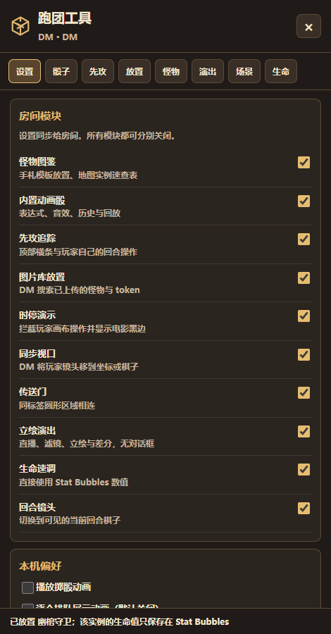
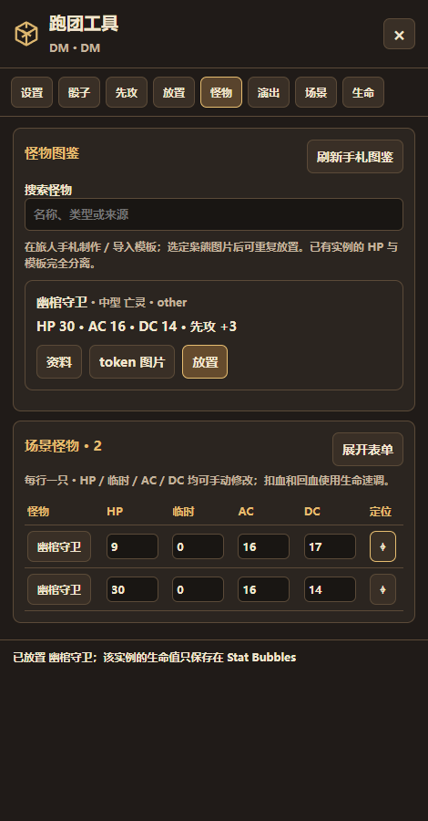
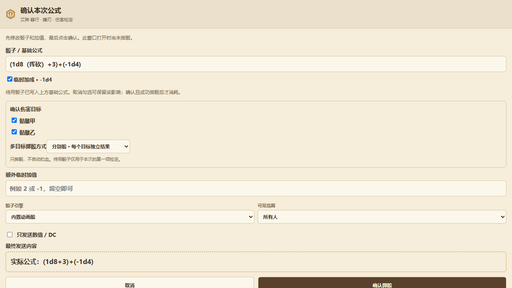

# 旅人手札 · Traveler Folio

可离线使用的中文 DND 角色卡工坊，以及 Owlbear Rodeo 角色卡联动与跑团工具。

当前版本 **0.27.0**，角色数据格式 **10**。

[下载最新版](https://github.com/Feathercatttt/traveler-folio/releases/latest) · [功能表与使用方法](docs/功能表与使用方法.md)

> **AI 代码说明**：本项目由 AI 辅助生成与维护，包含多个版本的增量代码。已执行本地、浏览器、原生应用及模拟多人检查；仍可能存在未覆盖的错误。真实枭熊多人房间与实体手机尚未完成实测。更新前请导出角色备份，首次使用新功能时先在测试房间核对结果。

## 下载与更新

在仓库右侧 **Releases** 下载最新版本：

| 文件 | 用途 |
| --- | --- |
| TravelerFolio-Windows-Light.zip | Windows x64安装包；缺少WebView2时可按启动提示联网安装或在浏览器打开 |
| TravelerFolio-Windows-Update.zip | 软件内使用的更新包；首次安装使用轻量包 |
| TravelerFolio-Android.apk | Android 8及以上，原签名可覆盖更新 |
| TravelerFolio-Owlbear.zip | 本地HTML与枭熊联动包 |
| TravelerFolio.html | 可直接本地打开的单文件角色卡 |
| TravelerFolio-Source.zip | 与发布版本对应的源代码 |

v0.19及以前需先手动安装v0.20一次。之后EXE及APK“设置 → 检查更新”可后台检查、镜像下载并确认安装。支持三条镜像、自动换线、签名校验和自定义镜像；公共服务不能保证所有国内网络永久可达。[更新步骤与线路设置](docs/更新与镜像下载.md)。

Windows公开Release不附带约214MiB的WebView2离线安装器；缺少内核时，EXE会提供微软官方联网安装或浏览器打开选项，不会静默安装。更新前建议导出备份。
保留角色数据不会依赖解压目录；二维码提供局域网的一次性数据快照传输。

## 枭熊安装

[线上插件地址](https://feathercatttt.github.io/traveler-folio/) · [v0.27操作指南](docs/v0.27安装与使用方法.md)

| 独立按钮 | DM 添加的安装地址 |
| --- | --- |
| 角色速查（先开EXE） | http://localhost:17632/manifest.json |
| 跑团工具 | http://localhost:17632/tools-manifest.json |

每位玩家先打开自己的 EXE，再进入房间。小卡恢复枭熊原生窗口并自动连接；不再需要额外连接弹窗。所有功能均由 EXE 本地插件提供，随手札更新。请停用旧的线上插件。停用同类旧扩展后刷新房间，避免重复后台。角色资料不会存到 GitHub Pages。

## 功能表

| 功能 | 操作入口 | 主要行为与权限 |
| --- | --- | --- |
| 规则记录 | 主界面“规则” | 独立村规条目、分类搜索、编辑删除与完整备份 |
| 自动更新 | EXE/APK“设置” | 启动后台检查、镜像换线、进度取消、签名核验，确认后安装 |
| 角色与职业 | 旅人手札主界面 | 主职业、两个副职业，共享角色等级与各职业等级分别设置 |
| 设置与卡库导航 | 左侧设置、收藏库、藏书架、怪物图鉴 | 工具集中设置；统一小收藏窗与两个可替换角色的大页面 |
| 公式示例 | 检定速查与掷骰框旁 ƒx | 悬停查看 / 点击或触屏展开；点示例复制优势、劣势、取最大及减骰公式 |
| 大卡模糊搜索 | 属性总览、特性、物品、法术 | 结果定位展开；检定另有骰子按钮；小卡保留原逻辑 |
| 属性联动与临时加成 | 数值输入框、状态编辑 | 支持 @数据与表达式，显示结果及来源 |
| 特性与收藏 | 特性页、藏书架 | 分类、次数恢复、多效果展开、DC和伤害公式 |
| 装备与物品 | 物品页 | 装备位、AC、武器专属公式及附属特性 |
| 法术 | 法术页 | 2014/2024版本标签、环位、施法属性和专注 |
| 召唤物 | 召唤物页 | 独立头像、属性、行动、攻击与生命速调 |
| 数据互通与卡库分发 | 互通 | 电脑出示二维码、APK应用内扫码；搜索勾选后单独分发卡片 |
| 枭熊绑定 | 枭熊手札小卡 | 将当前主卡/召唤物绑定到选中的token，联动HP、临时HP和AC |
| 独立跑团工具 | 枭熊插件按钮 | 原生面板点击开关，不可拖动；房间模块由 DM 分别开关 |
| 内置动画骰 | 卡上公式、跑团工具→骰子 | 先编辑再确认；音效、200条本机历史、原结果回放 |
| 动画展示模式 | 跑团工具→设置 | 排队默认关；最多3组并行、仅最近一次，或逐个排队 |
| 下一次检定骰子 | 特性/状态的数值影响 | 例如攻击 -1d4；成功投骰后消费，取消草稿不消费 |
| 多目标标记 | 枭熊画布按T | 当前小卡的绑定token发出玩家颜色连线，支持多选与目标环 |
| 多目标伤害投骰 | 伤害确认窗口 | 勾选目标，共用一次或各自独立投骰；记录对谁的结果 |
| 先攻追踪 | 地图先攻按钮、顶部固定条 | 72px 头像、可见血条、右键重骰/退出；结束清空；绑定卡加值同步 |
| 怪物图鉴 | 主页面左栏 → 右侧仓库 | 按物种、分类、等级、熟练加值筛选；可打开完整卡，六区编辑，不添加到玩家角色卡 |
| 图鉴与场上怪物 | 地图图鉴按钮、独立怪物列表 | 官方上传后放置 / 覆盖选中 token，两者注册场上列表；独立 HP/临时/AC/DC 与名称可改 |
| 手动生命调整 | 枭熊小心形按钮 | 任意Stat Bubbles token；先扣临时生命；绑定卡回传手札 |
| Marked状态 | 状态/数值影响编辑、状态速查工具 | 可选择不显示；保留图标、名称和底色，悬停/轻点查看说明 |
| 图片库快速放置 | 跑团工具→放置 | DM搜索官方已上传图片库，建立本机快捷列表 |
| 传送门 | 跑团工具→场景 | DM创建同标签圆形区域；进圈传送，临时挂起并恢复视野检测字段 |
| 立绘演出 | 地图演出按钮、跑团工具 → 演出 | 直播控制条切换滤镜、角色搜索/名单筛选、差分、授权移动缩放；空名单可结束 |

**所有目标、攻击与伤害操作都只负责标记和投骰，不会自动扣血。**
只有明确点击扣血/回血，或直接编辑实例HP，才会修改生命值。

## 常用操作

### 第一次绑定角色

打开EXE → DM安装并启用扩展 → 枭熊中打开手札小卡 → 选择角色或召唤物 →
地图选中一个token → 点击“绑定选中棋子”。主卡和每个召唤物分别绑定。

### 选择目标并投伤害

先在枭熊小卡切换到要行动的角色/召唤物，再点击画布按T。
逐个点击目标token，多次点击可以取消，Esc清空。随后点卡上的伤害公式，
在确认窗口勾选目标、修改骰子与临时加值，选择共用或独立结果，再确认。
需要扣血时另行使用生命速调。

### 准备战斗先攻

DM选择token加入先攻，也可添加环境等占位条目。绑定token读取其卡的先攻加值，
未绑定默认为0；怪物实例使用图鉴中的先攻。DM可以改加值或最终先攻，
“恢复卡值”取消手动覆盖。Owner玩家点击自己的“投先攻”，确认后DM开始战斗。
当前Owner可以结束回合。回合镜头可在设置中关闭。

### 制作并放置怪物

完整手札打开“怪物图鉴”，制作或导入JSON模板。枭熊进入“跑团工具→怪物”，
刷新图鉴，为模板选择已经上传的token图片，再点“放置”。
反复放置会产生多个独立实例；修改模板不会覆盖实例生命值。
实例表每行一只，可以手动改HP、临时HP、AC、DC，并点击定位。
图鉴起始为空，不附加网上整套怪物资料。

### 使用立绘剧场

选中自己拥有的token，在演出页选取立绘与差分。新图片需先上传到枭熊，
再通过图片库选入，保证其他电脑也能访问。右键token加入演出，DM开启直播。
舞台最多8人，每个token最多16张差分，支持切换、滤镜、排序和离场。

### 用手机接收电脑数据

电脑打开互通并出示二维码。APK内点击“互通→整卡互通 / 接收导入→扫描并接收电脑数据”，
允许相机权限，扫描、预览、确认导入。两端需要在同一局域网；这是快照转换，
不提供持续后台同步。卡库分发可以只勾选需要的物品、特性或法术。

## 功能概览

自定义角色、主副职业、种族、属性联动、特性/物品/法术收藏、多效果与召唤物。
枭熊工具含内置动画骰、历史回放、多目标伤害确认、先攻横条、怪物图鉴实例表、
快速放置、手动生命调整、视口同步、时停、传送门，以及不带对话框的立绘剧场。

**目标、攻击与伤害只负责标记和投骰，永远不自动扣血。**
怪物模板与地图实例分离，实例血量只保存在各自的Stat Bubbles元数据中。
完整操作说明见 `outputs/v0.19更新与使用说明.txt`。

## 界面预览

| 独立跑团工具 | 怪物实例表 |
| --- | --- |
|  |  |

## 开发

- HTML：`python work/assemble-v13.py`。修改增量模块，不直接修改生成HTML。
- 枭熊：进入 `outputs/owlbear/src`，运行 `npm install --ignore-scripts` 和 `npm run build`。
- Windows：`python work/build-windows.py`，依赖.NET Framework编译器、Pillow与WebView2 SDK。
- Android：`python work/build-android.py`，需要JDK21与Android SDK36，ZXing3.5.3。

发布签名私钥与口令不包含在仓库；重新生成的签名不能覆盖旧签名APK。
维护者应在自己的设备妥善保留原始发布签名。
原生构建脚本包含开发设备路径，需要按开发环境调整。
浏览器测试中的宿主路径也需要相应调整。

## 验证边界

v0.20.0新增37项更新专项及回归检查，包含Windows实际替换/回滚、原生镜像下载、Android15系统覆盖安装与角色保留；验证报告在work/v20-*-report.json。

v0.19.0通过82项本地和模拟环境检查，包括真实本机桥接、Edge交互、Windows原生启动/浮窗，
以及Android15模拟器的Camera2二维码扫描和导入。
枭熊接口以SDK模拟多人宿主验证；真实登录房间与实体手机仍需实测。

## 来源与许可

枭熊骰子动画和音效代码改编自 [FullPeople/obr-suite](https://github.com/FullPeople/obr-suite)，
固定参考提交 `2b91206610066716121f73c672c8ee3661e0839a`，遵循GPL-3.0-or-later。
对应源码在 `outputs/owlbear/src/vendor/suite19`，许可证与音效声明在 `outputs/owlbear`。
演出功能参考Visual Novel Maker的行为并独立实现，没有复制该FVTT模组的代码或资产。
Owlbear SDK、ZXing、WebView2、fflate和二维码库保留各自许可证。
内置规则文本与用户素材保持各自原有权利归属，程序代码许可证不授予这些内容的额外权利。
